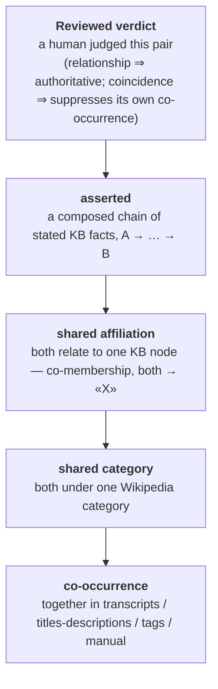

# How the connection explorer answers honestly

The connection explorer answers "how are entity A and entity B connected?" The hard part is not
finding *a* path — it is refusing to present a meaningless or misshapen one as if it were real.
This page explains the tiers it searches, the shapes it distinguishes, the four honesty rules that
keep its answers trustworthy, and — for the web surface added in Feature 113 — the serving-state
contract that keeps a half-built graph from ever answering, and how the browser renders a connection
without being able to disagree with the server.

The capability has **two surfaces** over the **same engine** (`Neo4jGraphRepository` +
`ConnectionService`): the `chronovista graph connect` CLI (Feature 112) reads a **dev-scoped**
graph, and the web Connection Explorer at `/connections` (Feature 113) reads the **production**
graph that ships in the main Docker stack. See [Where the graph runs](#where-the-graph-runs-dev-vs-production).

For how to run it, see [See how two entities connect](../user-guide/connection-explorer.md). For
the three kinds of fact it reads over, see [The knowledge model](knowledge-model.md).

## The tiers

A connection is assembled from independent tiers, each a bounded read against the graph:

The result carries the reviewed verdict (if any) plus **one labelled chain per kind**. The order
is fixed and categorical — it is *not* a cross-kind strength ranking (see
[By kind, not by strength](#by-kind-not-by-strength)).

## Shape, not just existence

The first honesty rule is about the *shape* of a knowledge-base link. Two entities can relate to
a common node `m` in two different ways, and they mean opposite things:

- **A composed chain** — `A → m → B` (the edge directions compose). "A founded m, and m employs
  B" is a genuine two-step fact *about these two*. This is the **asserted** tier, found by a
  **directed** shortest-path over knowledge-base edges.
- **A convergence** — `A → m ← B` (both point at `m`). "A and B both received award m" is
  co-membership, not a chain. Rendering it as `A —[RECEIVED]→ m —[RECEIVED]→ B` would assert that
  *m received the award from B* — a fact the knowledge base never states.

An earlier version searched an *undirected* path and printed the nodes positionally, which
fabricated exactly that false direction, and also let a stub node with hundreds of inbound edges
act as a transit hub. The fix is the **shape-split**: the asserted tier is a directed chain;
convergence falls to the **shared affiliation** tier and renders "both → «X»". A directed query
also means a stub (which has no outbound edges) can only ever be a shared endpoint, never a
transit node — the hub problem disappears by construction.

## Specificity, and self-suppression (SC-002)

The second rule: a connection is only as meaningful as it is *specific*. Both the
shared-category and shared-affiliation tiers score by **log-specificity**:

- a shared category scores `Σ max(0, ln(1e6 / globalSize(c)))` over the shared categories;
- a shared affiliation scores by the shared node's **local degree** — how many library entities
  share it.

A near-universal grouping ("both are living people", a node everything links to) has a term that
**floors to exactly zero**, so a broad-grouping-*only* overlap scores 0 and is **not emitted at
all** — not shown with a low score, simply absent. This is success criterion **SC-002**, and it
holds *by construction*: the floor is in the formula, so there is no sampling that could let a
junk grouping through. A mutation-verified unit invariant and a DB-gated check over the hub-only
population both guard it.

The asserted tier is scored too, by its **weakest intermediate hub**: a chain through a mega-hub
reads low, flagging that it is barely a connection between *these two* — the same idea applied to
chains.

## By kind, not by strength

The third rule is the subtle one. The tiers are ordered — asserted before shared category before
co-occurrence — but that order is **categorical, not a numeric ranking**. The scores are on
**different scales**: the chain and affiliation tiers use `ln(entity_count / local_degree)` (a
local reference of a few thousand), while the category tier uses `ln(1e6 / globalSize)` (a global
reference of a million). Comparing a chain's `score 4.8` to a category's `score 47.8` is not
*wrong* — it is **undefined**. So:

- a score ranks chains against chains, categories against categories — **within a kind only**;
- the list order reflects the *kind* of connection, not a total strength ordering;
- cross-kind demotion is deliberately not attempted, because there is no common scale to demote
  on. The CLI says so on its own line, so a reader never mistakes position for strength.

## Qualify the absence

The fourth rule: "no connection" has two very different causes, and the tool must distinguish
them. When no knowledge-base path exists, the result reports each endpoint's **KB coverage**
(its count of knowledge-base edges). A pair where one endpoint has a single KB edge is almost
certainly an **enrichment gap** — the graph hasn't learned about it yet — not a stated
non-relationship. Coverage counts **Wikidata edges only**: reviewed edges are human judgments,
not knowledge-base coverage, so counting them would read a heavily-reviewed pair as well-covered
and hide the gap exactly when it is real.

## Proven absence, not a sampling artifact (FR-016)

Gap detection is entirely an absence claim, so every "no connection" must be a *searched* result,
never a cap that truncated early. The traversal ranks by path length and is bounded by a hop
budget — it never uses a result-count `LIMIT` as a filter on a variable-length match. A reported
"no asserted path" means "exhausted within the hop bound", and the result marks itself
**bounded** (`any_truncated`) so the absence is never overstated as absolute. Guards assert both
properties: the queries carry no write clause (read-only, FR-008) and no `LIMIT`-as-filter
(FR-016).

## Reviewed coincidence

A human can review a pair's co-occurrence as *coincidental*. That verdict is the least-reliable
class, so it is handled carefully:

- it suppresses **only** the pair's co-occurrence channels — never an asserted or category tie;
- it is **origin-gated**: a human-confirmed coincidence suppresses; a machine-suggested one is
  treated as no verdict;
- the inferred chains are always still computed, so a mistaken coincidence stays recoverable.

## Where it sits

The explorer is read-only and lazily connected: a `Neo4jGraphRepository` owns the Cypher, a
`ConnectionService` owns the policy (the reviewed short-circuit and the coincidence suppression),
and the CLI only renders. The graph is stamped `layer='wikidata'` at load so knowledge-base facts
are told from the reviewed and co-occurrence layers by one drift-proof predicate.

## Never answer from a half-built graph (the serving-state contract)

Opening the explorer to the web (Feature 113) adds a failure the CLI could largely ignore: a user
can ask for a connection *while the graph is being rebuilt*. A rebuild wipes and reloads layers, so
mid-rebuild the graph is real, reachable, and **wrong** — a query against it would return a path
that is missing half its edges, or an empty result that looks exactly like an honest "no
connection." The whole value of the feature is that its "no" is trustworthy, so a degraded graph
answering at all is the one outcome that must never happen.

The fix is a **serving-state contract** with one home (`graph/serving_state.py`), shared by the four
destructive loaders and the read API and held in place by a mutation-verified fitness test. Three
ideas carry it:

- **Declared, not inferred.** Each build records in a label-isolated `:Meta` node which layers it
  was *configured* to contain (`declaredLayers`). The serving check compares the layers actually
  **present** against that **declared** set — never against a fixed "all layers always present"
  assumption, and never against whether an input file happens to exist. The asymmetry is
  deliberate: a layer a build declared it would include but which is **absent** makes the graph
  **not-servable** (an accidental loss fails loud and cheap), while a layer absent **by
  declaration** is fine (the reviewed layer is declared-optional — a fresh deployment that has no
  reviewed-verdict input declares it won't be built, and still refreshes cleanly). Inferring "skip"
  from a missing file would let an accidental loss silently serve a degraded graph.
- **The declared set describes the build, not live config.** It is read from `:Meta`, recorded at
  build time — never from configuration at serve time. Editing the expected layer set without
  reloading cannot retroactively mark a correctly-built graph unservable; the change takes effect at
  the next refresh.
- **A re-entrant bracket.** `:Meta.bracketDepth` counts nested open/close across the four
  independently-runnable loaders; `status` is `complete` only at depth 0. The single production
  refresh (`reload_all.sh`) holds an **outer** bracket around all four, so an orchestrated reload
  never flips the graph servable *between* layer steps — it is `loading` from the first wipe to the
  last load. A standalone loader still brackets correctly on its own.

The API serves a connection only when the build is `complete` **and** every declared layer is
present (`serving_state.is_servable`, the one pure predicate both the loaders and the read path
use). So a mid-rebuild, partially-wiped, or never-loaded graph is reported **"not available,"**
never mistaken for "no connection." That this gate is honoured by *every* rebuild path — not just
the ones that exist today — is enforced by an automated test, so a future loader cannot silently
bypass it (FR-018). This is success criterion SC-003: throughout a rebuild window the feature
returns zero connections and zero "no connection" verdicts, only the unavailable state.

## The five honest states

The CLI already distinguished "found," "none," and "unavailable." The web surface draws a finer line
because a browser user cannot read a stack trace, and must never be shown a technical failure as if
it were a factual answer. Feature 113 keeps **five** outcomes strictly apart (FR-009), and the
frontend keys on the HTTP **status** of the request, not on any graph-specific error string:

1. **Connected.** A path (or a reviewed relationship) exists. A human-reviewed **`relationship`**
   verdict reads as connected **even with zero inferred chains** — a confirmed tie the knowledge
   base may not yet state — and is drawn as an explicit A→B edge so it appears in both the graph and
   the table.
2. **No knowledge-base connection.** A genuine "no path" result (HTTP 200, empty chains). The view
   reports each endpoint's **KB coverage** and a **link to its external record**; an un-enriched
   endpoint gets a Wikidata-search fallback, so the gap case always offers a next action (FR-012,
   SC-006).
3. **Graph unavailable** (HTTP 503). Distinguishes **rebuilding** ("try again shortly") from
   **never loaded / unreachable** ("load the graph, then retry"), each naming its own next action.
4. **Not in the current graph** (HTTP 404). A valid id that the current graph does not contain —
   because the graph is a periodically-rebuilt projection that can lag the library. This is
   explicitly *not* "no connection," and not an error.
5. **Error** (anything else). A generic failure with a retry.

A **"graph as of &lt;date&gt;"** line (from `loaded_at`) is shown whenever the graph is servable, so
the user can judge currency (FR-017).

## The web surface: one model, two views

The browser must not be able to show a graph that disagrees with its own accessible table — if the
two drifted, the screen-reader path would be a second, untrusted source of truth. The design forbids
that by construction: a single **pure transform** (`connectionModel.ts`) turns the API's
`GraphConnection` into one renderable model of nodes and edges, and **both** the Cytoscape.js graph
and the edge-list table are built from that one model (FR-005, SC-004). The table is the canonical,
keyboard-and-screen-reader-operable view; the graph is a focusable `role="img"` that never traps Tab.

Two rendering rules protect the honesty of the picture:

- **Specificity is server-computed; the browser never recomputes it.** A category bridge node's
  size comes from the server's log-specificity (`GraphNode.specificity`, the same value the engine
  scores with) through a *linear* client-side map. The log is applied once, server-side, so the
  displayed emphasis cannot disagree with the engine's own measure (FR-008).
- **Co-occurrence stays a separate overlay.** Co-occurrence edges are flagged `overlay` and drawn as
  a distinct dashed curve, and are even excluded from the force layout so they do not pull the two
  endpoints together and imply a knowledge-base proximity that isn't there (FR-007). They are never
  merged into the shortest-path edges.

Encoding adds meaning in colour without ever depending on it (FR-025): line **style** carries
connection kind, node **shape** carries role, node **size** carries category specificity, and every
node and edge carries a text **label**. Node **colour** encodes **entity type** (with two muted
neutrals for the structural *category* and *reference-value/bridge* kinds), defined once in
`entityTypes.ts` (`GRAPH_STRUCTURAL_COLORS` plus the per-type map) so the graph stylesheet and the
on-screen legend read the same values. The palette is the dataviz categorical set, chosen for
colour-vision safety and held by an OKLab-distance test that keeps every fill perceptually distinct
from the others and from the typed hues. Because role, kind, specificity and identity each have a
non-colour channel — and the accessible table carries everything — no information depends on colour
alone.

## Explore mode: the neighborhood view (Feature 115)

Connect returns the single cleanest *path* between two entities. Explore answers the complementary
question — the **neighborhood** — and returns a different shape: a bounded node-and-edge **subgraph**,
not a set of A→B chains. The two modes share the same renderer and the same accessible table (the
one-model-two-views rule above still holds); Explore just feeds that renderer a `GraphSubgraph`
instead of a `GraphConnection`.

Three design points carry over from the engine's honesty rules and a prior measurement:

- **Trust layers are server-assigned, consumed verbatim.** Every edge is classified once, on the
  server, into `verified` / `category` / `co_occurrence` (the `EdgeLayer` taxonomy — the single home
  for the mapping, guarded by a contract test). The browser styles by that layer and never
  re-derives it from the edge type (FR-024), so the picture cannot disagree with the engine. The
  classifier folds the graph's two "stated" edge kinds — Wikidata facts and human-reviewed
  relationships — into *verified*, and a reviewed *coincidence* verdict into *co-occurrence*, since a
  coincidence is the opposite of a verified tie.
- **The cap keeps facts over hints.** A neighborhood is bounded — a legible initial load (default 60)
  growing by expansion to a ceiling (default 250). When a cap binds, co-occurrence edges are dropped
  **before** verified ones (FR-004). This encodes the finding that co-occurrence means "discussed
  together", not "related": it is shown (opt-in), distinctly, but it is the first thing sacrificed
  for legibility and never crowds out a fact.
- **Read-only, and only what's loaded.** Explore infers nothing. It renders relationships already in
  the graph; the "extract new relationships from transcripts" idea a prior spike refuted is
  deliberately absent.

The endpoint is `GET /api/v1/graph/neighborhood` — read-only, behind the same servability gate and
RFC-7807 error mapping as `/graph/connect` (503 for a degraded graph, 404 for a seed absent from the
current graph, 422 for invalid parameters). Expansion is the same endpoint re-seeded on one node and
merged client-side, so the layout the user has arranged is preserved.

Two refinements keep Explore legible without weakening the one-model rule:

- **Focus filters run through the same model.** Toggling a node's entity type or an edge's
  relationship type off never reaches into the canvas directly; it computes a hidden-id set from the
  one shared model, and *both* the Cytoscape graph (which hides those elements in place) and the
  accessible table (built from the model minus those ids) consume it — so a filter can never make the
  two views disagree (SC-004). Hiding an entity type never hides the two endpoints, and hiding a node
  takes its incident edges with it. A property test asserts the table's rows equal the graph's
  visible edges across filter combinations.
- **The arranged layout survives navigation.** The Cytoscape instance is destroyed when the page
  unmounts, so returning would otherwise re-run a randomized layout. A small module-level cache keyed
  by the seed pair remembers each graph's node positions and viewport — saved when the layout settles
  and on unmount — and on return to the same graph they are reapplied as a fixed `preset` with no
  randomized layout, so the view comes back exactly as it was left. The from-scratch layout also runs
  only when nothing is mid-animation: an earlier defect stopped an in-flight layout on a no-op
  re-render, freezing the nodes mid-spread into a line. (Expanded nodes, which live in component
  state, are not yet persisted.)

## Where the graph runs: dev vs production

The two surfaces read two different Neo4j instances, and conflating them is the easy mistake:

- **The CLI** (`chronovista graph connect`) reads a **dev-scoped** Neo4j you start yourself — a
  profile on `docker-compose.dev.yml` — and load with `reload_all.sh`. It is a lab tool and is not
  part of any deployed stack.
- **The web explorer** is served by the production app against the **production** Neo4j that
  Feature 113 added to `docker-compose.yml`. That service has **no published host ports** — bolt
  (7687) and the admin console (7474) stay on the internal Docker network, reachable only by the app
  (FR-019, SC-008). The app connects lazily and degrades gracefully, so it depends on the graph as
  `service_started`, not `service_healthy` — a down graph yields the honest unavailable state, never
  a failed app boot (Principle VIII). The destructive-load safety guard that keeps a graph load from
  reaching an unintended remote datastore remains in force in the deployed configuration (FR-020).

## The read-only API

Features 113 and 115 expose four read-only endpoints under `/api/v1/graph/*`, all behind auth, all
through the read-only repository. They are documented as reference in the
[API overview](../api/index.md#connection-graph-feature-113) and
[error responses](../api/error-responses.md#connection-graph-errors); the design points are:

- `GET /graph/health` returns the `ServingHealth` the serving-state contract computes. It **degrades
  gracefully** — an unreachable graph reads as `servable: false`, not a 500 — because health is
  exactly the question "can I trust this graph?", and a transport failure is a legitimate "no."
- `POST /graph/entities` powers the graph-present-only picker (FR-002): given up to 500 entity ids,
  it returns the subset present in the graph. On an unavailable graph it returns an empty set
  (nothing is *known* present) rather than erroring.
- `GET /graph/connect` is the only endpoint that **refuses** a degraded graph: it re-checks
  servability on every request and returns **503** rather than a result, so the servability gate is
  not a one-time check that a mid-session rebuild could slip past. A valid id absent from the current
  graph is a **404** (distinguished by its detail text, not a bespoke type), and `a == b` or
  `max_hops < 3` is a **422**.
- `GET /graph/neighborhood` (Feature 115) backs Explore: it returns a bounded `GraphSubgraph` around
  one or two seeds behind the **same servability gate** as `/graph/connect` (503 / 404 / 422). Each
  edge carries its server-assigned trust **layer** — the single home for that classification, which
  the browser consumes verbatim rather than re-deriving, so the picture can't disagree with the
  engine.

The frontend keys on the HTTP status (503 / 404 / 422), not on a graph-specific `type` URI, so the
honest states map onto the shared RFC-7807 problem vocabulary (Feature 013) without inventing new
error codes.
