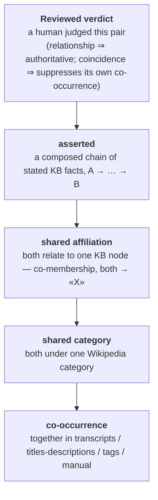

# How the connection explorer answers honestly

The connection explorer answers "how are entity A and entity B connected?" over a dev-scoped
graph. The hard part is not finding *a* path — it is refusing to present a meaningless or
misshapen one as if it were real. This page explains the tiers it searches, the shapes it
distinguishes, and the four honesty rules that keep its answers trustworthy.

For how to run it, see [See how two entities connect](../user-guide/connection-explorer.md). For
the three kinds of fact it reads over, see [The knowledge model](knowledge-model.md).

## The tiers

A connection is assembled from independent tiers, each a bounded read against the graph:

The result carries the reviewed verdict (if any) plus **one labelled chain per kind**. The order
is fixed and categorical — it is *not* a cross-kind strength ranking (see
[By kind, not by strength](#by-kind-not-by-strength)).

## Shape, not just existence

The first honesty rule is about the *shape* of a knowledge-base link. Two entities can relate to
a common node `m` in two different ways, and they mean opposite things:

- **A composed chain** — `A → m → B` (the edge directions compose). "A founded m, and m employs
  B" is a genuine two-step fact *about these two*. This is the **asserted** tier, found by a
  **directed** shortest-path over knowledge-base edges.
- **A convergence** — `A → m ← B` (both point at `m`). "A and B both received award m" is
  co-membership, not a chain. Rendering it as `A —[RECEIVED]→ m —[RECEIVED]→ B` would assert that
  *m received the award from B* — a fact the knowledge base never states.

An earlier version searched an *undirected* path and printed the nodes positionally, which
fabricated exactly that false direction, and also let a stub node with hundreds of inbound edges
act as a transit hub. The fix is the **shape-split**: the asserted tier is a directed chain;
convergence falls to the **shared affiliation** tier and renders "both → «X»". A directed query
also means a stub (which has no outbound edges) can only ever be a shared endpoint, never a
transit node — the hub problem disappears by construction.

## Specificity, and self-suppression (SC-002)

The second rule: a connection is only as meaningful as it is *specific*. Both the
shared-category and shared-affiliation tiers score by **log-specificity**:

- a shared category scores `Σ max(0, ln(1e6 / globalSize(c)))` over the shared categories;
- a shared affiliation scores by the shared node's **local degree** — how many library entities
  share it.

A near-universal grouping ("both are living people", a node everything links to) has a term that
**floors to exactly zero**, so a broad-grouping-*only* overlap scores 0 and is **not emitted at
all** — not shown with a low score, simply absent. This is success criterion **SC-002**, and it
holds *by construction*: the floor is in the formula, so there is no sampling that could let a
junk grouping through. A mutation-verified unit invariant and a DB-gated check over the hub-only
population both guard it.

The asserted tier is scored too, by its **weakest intermediate hub**: a chain through a mega-hub
reads low, flagging that it is barely a connection between *these two* — the same idea applied to
chains.

## By kind, not by strength

The third rule is the subtle one. The tiers are ordered — asserted before shared category before
co-occurrence — but that order is **categorical, not a numeric ranking**. The scores are on
**different scales**: the chain and affiliation tiers use `ln(entity_count / local_degree)` (a
local reference of a few thousand), while the category tier uses `ln(1e6 / globalSize)` (a global
reference of a million). Comparing a chain's `score 4.8` to a category's `score 47.8` is not
*wrong* — it is **undefined**. So:

- a score ranks chains against chains, categories against categories — **within a kind only**;
- the list order reflects the *kind* of connection, not a total strength ordering;
- cross-kind demotion is deliberately not attempted, because there is no common scale to demote
  on. The CLI says so on its own line, so a reader never mistakes position for strength.

## Qualify the absence

The fourth rule: "no connection" has two very different causes, and the tool must distinguish
them. When no knowledge-base path exists, the result reports each endpoint's **KB coverage**
(its count of knowledge-base edges). A pair where one endpoint has a single KB edge is almost
certainly an **enrichment gap** — the graph hasn't learned about it yet — not a stated
non-relationship. Coverage counts **Wikidata edges only**: reviewed edges are human judgments,
not knowledge-base coverage, so counting them would read a heavily-reviewed pair as well-covered
and hide the gap exactly when it is real.

## Proven absence, not a sampling artifact (FR-016)

Gap detection is entirely an absence claim, so every "no connection" must be a *searched* result,
never a cap that truncated early. The traversal ranks by path length and is bounded by a hop
budget — it never uses a result-count `LIMIT` as a filter on a variable-length match. A reported
"no asserted path" means "exhausted within the hop bound", and the result marks itself
**bounded** (`any_truncated`) so the absence is never overstated as absolute. Guards assert both
properties: the queries carry no write clause (read-only, FR-008) and no `LIMIT`-as-filter
(FR-016).

## Reviewed coincidence

A human can review a pair's co-occurrence as *coincidental*. That verdict is the least-reliable
class, so it is handled carefully:

- it suppresses **only** the pair's co-occurrence channels — never an asserted or category tie;
- it is **origin-gated**: a human-confirmed coincidence suppresses; a machine-suggested one is
  treated as no verdict;
- the inferred chains are always still computed, so a mistaken coincidence stays recoverable.

## Where it sits

The explorer is read-only and lazily connected: a `Neo4jGraphRepository` owns the Cypher, a
`ConnectionService` owns the policy (the reviewed short-circuit and the coincidence suppression),
and the CLI only renders. The graph is stamped `layer='wikidata'` at load so knowledge-base facts
are told from the reviewed and co-occurrence layers by one drift-proof predicate.
