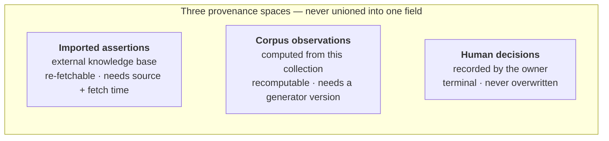

# The knowledge model

chronovista holds three different kinds of fact about the same entities, and keeps
them apart on purpose. This page explains what those kinds are, why they are never
merged, and how to tell which one a new feature produces. It is the page to check
when a change touches entities, relationships, or anything derived from the corpus.

For the tables these live in, see [Data Model](data-model.md); for the discovery
pipelines that feed them, see [Seed-and-grow discovery](seed-and-grow.md) and
[Novel-relationship discovery](relationship-discovery.md).

## Three spaces

Every fact in the entity layer belongs to exactly one of three spaces, and the space
determines its provenance, its lifecycle, and what may overwrite it.

| | **Imported assertions** | **Corpus observations** | **Human decisions** |
|---|---|---|---|
| Claim | about the world | about *this* collection | about what the owner accepts |
| Source | an external knowledge base | the videos, titles, descriptions, transcripts | a person |
| Example | a person's employer; a work's creator | two entities co-occur in 40 videos | "this alias is wrong"; "this grounding is correct" |
| Refresh | re-fetch from source | regenerate from the corpus | never automatically |
| Meaningless without | its source identifier and fetch time | the generator version that produced it | the person and the time |
| May be overwritten by | a later fetch from the same source | a later regeneration | nothing |

The third space is the one that constrains the other two. Anything a person sets is
terminal: automated passes skip it. That is why a declined grounding and an unchecked
one are stored as different states rather than one boolean — collapsing them makes a
half-finished run indistinguishable from a finished one.

## The rule: the typed skeleton and the observed layer are never unioned

The first two spaces have names in this codebase. The **typed skeleton** is the
imported graph: typed edges between entities, fetched by identifier from an external
knowledge base, each carrying its source and fetch time. The **observed layer** is
what this corpus says: which entities appear in the same videos, how often, and how
surprising that overlap is.

They are stored separately, surfaced separately, and **never combined into a single
"related to" relation.** This is not a stylistic preference. Merging them produces a
graph in which "the knowledge base asserts these two things are connected" and "these
two names happened to appear in the same videos" are indistinguishable — and once
they are indistinguishable, nothing downstream can tell a fact from a coincidence.
Every consumer that shows relationships therefore names its channel.

In standard terms this is the distinction between a **knowledge base** (asserted
facts, with provenance) and a **distributional association model** (statistics about
a text collection). The observed layer rests on the *distributional hypothesis* —
that an entity, like a word, is characterised by the company it keeps (Firth, 1957) —
which is what makes co-occurrence a meaningful signal and also what bounds it:
distribution captures association, not the typed relation a knowledge base asserts.
Conflating the two is the recognised failure mode in that literature, not a hazard
unique to this project.

## The test for a new feature

Before building anything that writes to the entity layer, name the space its output
lands in. A feature that cannot answer the question is the warning sign — not because
the answer is hard, but because an unnamed space defaults to whichever representation
was most convenient, which is how derived data ends up shaped like imported data.

Three worked answers:

- **Enrichment** writes imported assertions. It must record the source identifier and
  the time, must be re-fetchable, and must clear stale values rather than overwrite
  them in place — a partial refresh that leaves old values behind is a silent lie.
- **Co-occurrence and candidate scoring** write corpus observations. They must carry
  the generator version, because a score is uninterpretable without knowing how it
  was computed, and they must be safe to recompute wholesale.
- **A review verdict** writes a human decision. It must never be reshaped into either
  of the other two. The specific trap: writing an approved finding into the same
  representation the imported graph uses, where it becomes indistinguishable from an
  imported fact within one release.

## The same three shapes, in every subsystem

The three spaces are not only an entity-layer idea — the whole system is organised on
them. Every subsystem that holds a fact which could later turn out wrong places that
fact in one of the three, which is why the rules below transfer unchanged from one
subsystem to the next instead of being re-derived each time.

| Subsystem | Imported | Observed | Decided | Page |
|---|:---:|:---:|:---:|---|
| Entity grounding / enrichment | ● | | | [Re-grounding](entity-reground.md) · [how-to](../user-guide/entity-enrichment.md) |
| Deleted-video recovery | ● | | | [Recovery provenance](recovery-provenance.md) |
| Co-occurrence & candidate queue | | ● | ● *verdicts* | [Novel-relationship discovery](relationship-discovery.md) |
| Entity-mention detection | | ● | ● *manual* | [Alias→mention provenance](entity-alias-provenance.md) |
| Tag normalization | | ● *folding* | ● *merge* | [Tags and aliases](tags-and-aliases.md) |
| Transcript corrections | ● *ASR* | ● *suggested fix* | ● *acceptance* | [Correcting transcripts](../user-guide/corrections.md) |
| Channel ownership | ● | | | [Channel cast](channel-cast.md) · [how-to](../user-guide/channel-ownership.md) |
| Channel cast | ● *seed* | ● *detector* | ● *review* | [Channel cast](channel-cast.md) |

Transcript corrections spanning all three — an imported machine transcript, an
observed suggested fix, a decided acceptance — is the clearest evidence the frame
generalises: a domain that looks unrelated to entities turns out to have the identical
shape, and the same rules (re-fetchable source, versioned derivation, terminal
decision) apply to it verbatim.

## Where this sits in established practice

The project's shape is mainstream; the deviations are deliberate and in one
direction.

**Property graph, not a triple store.** Relationships are typed edges with
properties, stored relationally with a JSONB property bag and promoted to columns
when a query needs them. RDF and SPARQL are the interchange and academic standard,
and they are used *for reading* from external sources — but a local triple store was
evaluated and declined. Closed-world typed edges match the queries this application
actually runs, and a dedicated graph database is out of scope below roughly a
five-figure entity count. External provenance uses the source KB's own qualifier
mechanism rather than RDF reification: the cheap end of the provenance trade,
chosen knowingly.

**The vocabulary is SKOS-shaped, not OWL-shaped.** SKOS exists to organise a
controlled vocabulary *for retrieval*, where broader/narrower navigation is wanted
and logical class-membership claims explicitly are not. That is this project's goal:
reach many videos in few steps. The correspondence:

| chronovista | SKOS |
|---|---|
| an entity's canonical name | `skos:prefLabel` |
| alias rows | `skos:altLabel` |
| `subclass_of`, captured but never closed | `skos:broader` |
| `has_part` / `part_of` | `skos:broader` in its partitive sense |
| the co-occurrence spine | `skos:related`, but *derived from a corpus* |

The most important consequence is a validation rather than a change: **do not compute
subclass closure.** Non-transitivity is the correct SKOS position, because real
hierarchies mix generic, partitive and instantial relations, and chaining them
produces nonsense. The thesaurus standard ISO 25964 draws the same line explicitly,
splitting the broader-term relation into generic (BTG), partitive (BTP) and
instantial (BTI) variants precisely because the three do not compose. External
subclass chains are notoriously bad this way. Leaving the closure uncomputed is a
decision, not a deferred feature.

**What has no counterpart in any standard.** Hub suppression (whether an inverse list
is *useful* is not a logical property, so no formalism models it); per-alias case
sensitivity for mention matching; per-entity exclusion patterns; corpus-derived
relatedness separated by channel. The pattern is worth stating plainly, because it
tells you where to look things up and where to stop looking:

> The parts that were reinvented are the parts the formalisms cover. The parts that
> were invented are the parts no formalism covers.

The formalisms are about what is *true*. Every hard problem here is about what is
*useful for finding things in this corpus* — which is the territory SKOS was carved
out of OWL to occupy, and exactly where SKOS then stops.

## Entity types are an annotation tagset, not a subject vocabulary

`EntityType` derives from OntoNotes, a **named-entity annotation tagset**. Its job is
to label what kind of thing a *mention* refers to, so that a detector and a human
annotator can agree. That is a different job from organising a subject vocabulary,
and the two have different shapes: a tagset is flat and closed on purpose, while a
subject vocabulary is faceted and open.

This matters when a new subject area arrives. Classifying entities by *domain* —
rather than by what kind of thing they are — is a **facet** in the sense of faceted
classification (Ranganathan, 1933): an independent axis that *combines* with
person-versus-place rather than extending a single enumerative hierarchy that must
anticipate every category. A facet modelled as a new enum value costs a
CHECK-constraint migration per subject area; modelled as what it is, a scheme
membership on the existing subtype column, it costs a row. So if a third domain ever makes the current
split feel inadequate, that pressure is a modelling artifact and should not be
resolved by adding an enum value.

## Standing rules

- Name the space before writing the feature.
- Never union the typed skeleton with the observed layer; name the channel instead.
- Derived facts carry the version of the thing that derived them.
- Human decisions are terminal, and "declined" is not "unchecked".
- Record provenance at the grain you will later need to repair at: a change recorded
  as a deletion leaves nothing to inspect or reverse, while the same change recorded as
  a tombstone with a forwarding address stays a readable, repairable fact.
- Do not compute subclass closure.
- One dimension per vocabulary: a tagset labels what a thing *is*, and a subject domain
  is a separate facet that combines with it — never a new value forced into the same
  column.
- Adopt SKOS's vocabulary and its non-transitivity; do not adopt RDF's machinery.
- Keep inventing below that line, because that layer knows about this corpus and no
  standard will.

## Further reading

- Firth (1957), "A Synopsis of Linguistic Theory 1930–1955" — the "company it keeps"
  statement of the distributional hypothesis the observed layer rests on.
- Ranganathan (1933), *Colon Classification* — faceted classification: independent
  axes that combine, rather than one enumerative hierarchy.
- ISO 25964-1 (2011), *Thesauri and interoperability with other vocabularies* — the
  generic / partitive / instantial split in broader-term relations.
- Miles & Bechhofer (2009), *SKOS Simple Knowledge Organization System Reference*
  (W3C) — `prefLabel`, `altLabel`, `broader`, `related`.
- Hovy, Marcus, Palmer, Ramshaw & Weischedel (2006), "OntoNotes: The 90% Solution" —
  the annotation tagset `EntityType` derives from.

## See Also

- [Data Model](data-model.md) — the tables, and the decisions embedded in them
- [Seed-and-grow discovery](seed-and-grow.md) — growing the typed skeleton outward
- [Novel-relationship discovery](relationship-discovery.md) — measuring the gap
  between the two layers
- [Ground entities in a knowledge base](../user-guide/entity-enrichment.md) — the
  how-to for imported assertions
- [Glossary](../glossary.md)
